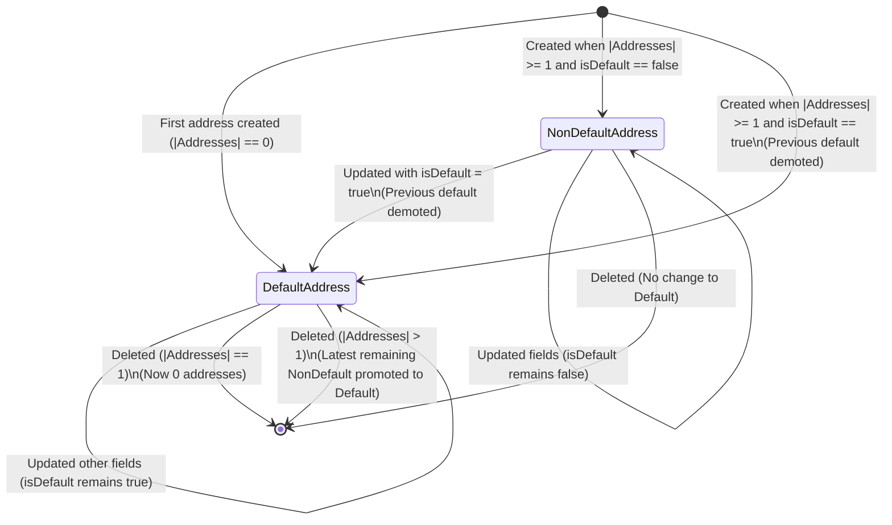

# Data Model: Address CRUD

## Overview
This document defines the entity model, relationships, invariants, validation rules, and state transitions for user shipping addresses in the e-commerce backend.

---

## 1. Entity Definitions

### 1.1 `Address` (Database & Domain Model)

Represents a reusable shipping destination in a customer's address book.

| Field | Type | Prisma / DB Type | Required | Default | Description |
|---|---|---|---|---|---|
| `id` | `number` | `Int @id @default(autoincrement())` | Yes | Auto | Unique identifier for the address |
| `userId` | `number` | `Int` | Yes | None | Foreign key referencing `User.id` |
| `label` | `AddressType` | `enum ("home", "office", "other")` | Yes | None | Category label for the address |
| `fullName` | `string` | `Text` | Yes | None | Recipient full name (max 100 chars) |
| `phone` | `string` | `Text` | Yes | None | Contact phone number (7-20 chars) |
| `street` | `string` | `Text` | Yes | None | Street address lines (max 255 chars) |
| `city` | `string` | `Text` | Yes | None | City name (max 100 chars) |
| `province` | `string` | `Text` | Yes | None | Province / State / Region (max 100 chars) |
| `postalCode` | `string` | `Text` | Yes | None | Postal or ZIP code (max 20 chars) |
| `country` | `string` | `Text` | Yes | None | Country name (max 100 chars) |
| `isDefault` | `boolean` | `Boolean` | Yes | `false` | True if this is the active default shipping address |
| `createdAt` | `Date` | `DateTime @default(now())` | Yes | `now()` | Record creation timestamp |

### 1.2 Enums

#### `AddressType`
```prisma
enum AddressType {
  home
  office
  other
}
```

---

## 2. Relationships

```
+----------------+          1 : N          +----------------+
|      User      | ------------------------< |    Address     |
+----------------+                           +----------------+
                                                     |
                                                     | 1 : N (Optional)
                                                     v
                                             +----------------+
                                             |     Order      |
                                             +----------------+
```

- **`User` -> `Address`**:
  - `User.addresses` has a one-to-many relationship with `Address`.
  - Foreign key: `Address.userId` references `User.id`.
  - Scoping: All address operations require `userId = authenticatedUser.id`.

- **`Address` -> `Order`**:
  - `Order.shippingAddressId` is an optional foreign key (`Int?`) referencing `Address.id`.
  - Referential action: `ON DELETE SET NULL`. Deleting a saved address in the user's address book preserves existing orders and clears only the active address book link. Order-level historical snapshot fields (`shippingFullName`, `shippingPhone`, `shippingStreet`, `shippingCity`, `shippingProvince`, `shippingPostalCode`, `shippingCountry`) remain permanently immutable.

---

## 3. Invariants & Business Rules

1. **Default Address Cardinality Invariant**:
   - For any given user $U$:
     $$\sum_{A \in \text{Addresses}_U} [A.\text{isDefault} = \text{true}] = \begin{cases} 0 & \text{if } |\text{Addresses}_U| = 0 \\ 1 & \text{if } |\text{Addresses}_U| \ge 1 \end{cases}$$
   - A user can never have more than one default address.
   - If a user has one or more addresses, exactly one address must have `isDefault: true`.

2. **First Address Rule**:
   - When $|\text{Addresses}_U| = 0$, creating a new address forces `isDefault = true`, regardless of whether `isDefault` was supplied in the payload.

3. **Promotion on Create/Update**:
   - Marking an address with `isDefault = true` on create or update atomically demotes all other addresses of that user to `isDefault = false` within a database transaction.

4. **Demotion Rejection**:
   - An explicit update setting `isDefault = false` on an address where `isDefault == true` is rejected with `400 Bad Request`. Users must designate an alternative default address instead.

5. **Auto-Promotion on Delete**:
   - If an address with `isDefault = true` is deleted and remaining addresses exist ($|\text{Addresses}_U| \ge 1$), the remaining address with the most recent `createdAt` timestamp is automatically updated to `isDefault = true`.
   - If no addresses remain, the user has 0 addresses and 0 defaults.

6. **Ownership Isolation**:
   - All lookups, updates, and deletions query by composite predicate `{ id, userId }`.
   - Any query returning no matching row results in `404 Not Found` to prevent account ID probing.

---

## 4. Validation Rules & Field Constraints

| Field | Validation Decorators | Rules / Constraints |
|---|---|---|
| `label` | `@IsEnum(AddressType)` | Must be one of: `home`, `office`, `other`. |
| `fullName` | `@IsString()`, `@IsNotEmpty()`, `@MaxLength(100)` | Non-empty string, trimmed, 1-100 characters. |
| `phone` | `@IsString()`, `@IsNotEmpty()`, `@MaxLength(20)`, `@Matches(/^[+0-9\s\-()]{7,20}$/)` | Allowed characters: digits, spaces, `+`, `-`, `(`, `)`. Length 7-20. |
| `street` | `@IsString()`, `@IsNotEmpty()`, `@MaxLength(255)` | Non-empty string, trimmed, 1-255 characters. |
| `city` | `@IsString()`, `@IsNotEmpty()`, `@MaxLength(100)` | Non-empty string, trimmed, 1-100 characters. |
| `province` | `@IsString()`, `@IsNotEmpty()`, `@MaxLength(100)` | Non-empty string, trimmed, 1-100 characters. |
| `postalCode` | `@IsString()`, `@IsNotEmpty()`, `@MaxLength(20)` | Non-empty string, trimmed, 1-20 characters. |
| `country` | `@IsString()`, `@IsNotEmpty()`, `@MaxLength(100)` | Non-empty string, trimmed, 1-100 characters. |
| `isDefault` | `@IsBoolean()`, `@IsOptional()` | Boolean value (`true` or `false`). Defaults to `false` if omitted on creation. |

---

## 5. State Transitions


